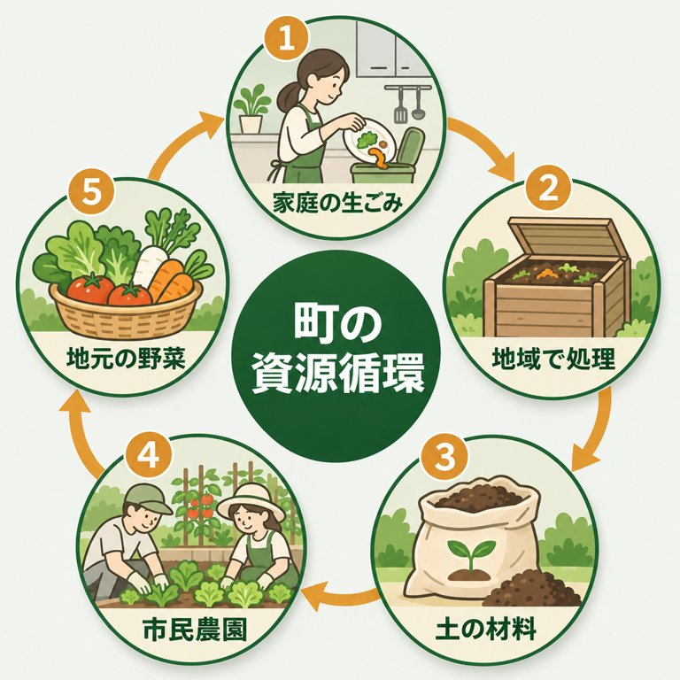

# ai-visual-playbook

**Prompt recipes and templates for making infographics, illustrations, slides and short videos with image-generation AI.**
Distilled from a year of real business work at a small company (thousands of figures, hundreds of videos): only the phrasings that worked and the pitfalls we actually hit.
Tracing a proven pattern and swapping in your content is faster, cheaper and more consistent than starting from scratch.

The skill bodies are written in Japanese, but every prompt block in `references/` is in English and can be pasted as-is.

## What's inside

| Skill | What it does |
|---|---|
| `image-prompt-recipes` | Infographics with accurate text (incl. Japanese, Vietnamese, Thai), illustrations, transparent icons, slide-bottom scenery bands, photo-style heroes. 12 style headers, 12 diagram-type content templates, per-language typography lines, guard sentences that stop extra text, a QA checklist, and how to turn existing images into text "recipes" so they can be regenerated anywhere. `scripts/gen_image.py` wraps the OpenAI Images API (fallback models, transparency, trimming, text-swap editing). |
| `slide-design-recipes` | Content JSON → editable PPTX in 7 designs, python-pptx only (no PowerPoint needed). Scenery bands, multilingual font pitfalls (Thai needs `a:cs`), self-check on save. |
| `video-format-recipes` | A catalog of short-video formats with beat tables, prompt patterns for video models / music / narration, assembly and automated QA, and pitfalls. |

## Install

- **Claude Code**: `/plugin marketplace add chikuwabudelicious/ai-visual-playbook` then `/plugin install ai-visual-playbook`, or copy folders under `skills/` into `~/.claude/skills/`.
- **Codex**: copy folders under `skills/` into `~/.codex/skills/`.
- **claude.ai**: zip each skill folder and add it under Settings → Skills.

Requirements: `OPENAI_API_KEY` + `pip install openai pillow` for images; `pip install python-pptx pillow` for slides. Model names and prices are as of November 2026 and will change — check your provider's model list first.

## Principles

- Never present generated images as field records or proof of results.
- Check every number and proper noun against your source after each generation.
- Don't generate faces of real people, logos, real landmarks or trademarks.
- Follow your publishing platform's rules and local law on labeling AI-generated content.

## License

MIT.
