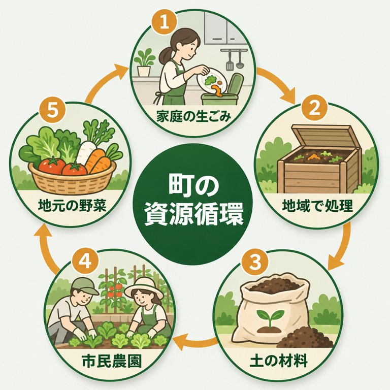

# ai-visual-playbook

画像生成AIで、図解・挿絵・スライド・短い動画を作るための**プロンプト集と雛形**。
中小企業の実務で1年間、数千枚の図と数百本の動画を作るなかで、効いた書き方と踏んだ罠だけを残した。
一から試行錯誤するより、近い型をなぞって中身を差し替えるほうが、早く・安く・品位も安定する。

English: [README.en.md](README.en.md)



*上の図は、このパックの型（画風 S1＋循環図のテンプレ＋決まり文句）をそのまま使って1回で出たもの。*

## 入っているもの

| スキル | できること |
|---|---|
| [image-prompt-recipes](skills/image-prompt-recipes/SKILL.md) | 文字入りインフォグラフィック・挿絵・アイコン・帯・写真風。画風の頭文12種、図の種類別テンプレ12種、言語別の文字指定、余計な文字を足させない決まり文句、点検の手順、画像を「レシピ」に書き起こして別環境で作り直す方法 |
| [slide-design-recipes](skills/slide-design-recipes/SKILL.md) | 原稿 JSON → 編集できる PPTX（7意匠）。PowerPoint 不要。下端の風景の帯、多言語の書体の罠、自己検査つき |
| [video-format-recipes](skills/video-format-recipes/SKILL.md) | 短い動画の「型」のカタログ（拍の表つき）、映像・BGM・ナレーションの指示の型、組み立てと機械QA、踏んだ罠 |

## 使い方

**Claude Code**（プラグインとして）：

```bash
/plugin marketplace add chikuwabudelicious/ai-visual-playbook
/plugin install ai-visual-playbook
```

または `skills/` の中のフォルダを `~/.claude/skills/` に写す。

**Codex**：`skills/` の中のフォルダを `~/.codex/skills/` に写す（SKILL.md の形式は共通）。

**claude.ai**：設定の「スキル」から、各スキルのフォルダを zip にして追加する。

**AI を使わない場合**：`references/` の英文をそのまま画像生成サービスに貼れば使える。

## 必要なもの

- 画像：OpenAI の API キー（`OPENAI_API_KEY`）、`pip install openai pillow`。プロンプトだけなら他のサービスにも貼れる。
- スライド：`pip install python-pptx pillow`（API キー不要）。
- 動画：各スキルの SKILL.md を参照（HTML→MP4 は Node・ffmpeg・Chrome）。

モデル名・料金は 2026年11月時点のもの。変わるので、使う前に各サービスのモデル一覧で確かめる。

## 方針

- 生成した画像を「現地の記録」「実績」として使わない。説明のための情景として扱う。
- 数字と固有名詞は、生成のたびに原稿と照合する。生成は焼き込みの字を間違える。
- 人の顔・ロゴ・実在の建物や商標を描かせない。
- 生成物であることの表記は、公開先の規約と法令に従う。

## ライセンス

MIT。プロンプトも、そのまま自分の仕事・商用に使ってよい。
